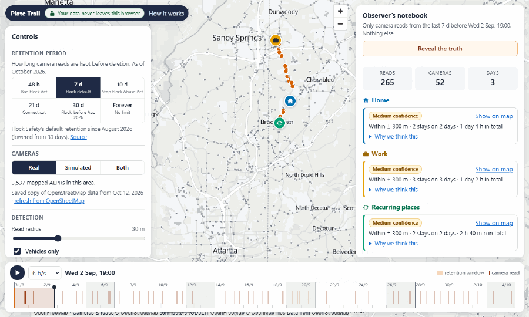
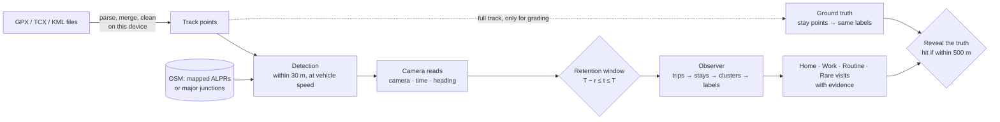

# Retention Window

**What would a licence-plate camera network learn about your week — and how much does the data-retention period change that?**



**Live demo:** https://kats0ulas.github.io/retention-window/ · runs entirely in your browser · MIT licence

Load your own GPS history (GPX/TCX/KML) or click **Try the sample week**. The app places automatic licence-plate reader (ALPR) cameras on the map — real ones mapped in OpenStreetMap, or hypothetical ones at every major junction — replays your movements the way the camera network would record them, and lets an “observer” infer your home, workplace, routine and rare one-off visits from the camera reads alone. A retention selector limits what the observer can still see, and **Reveal the truth** grades every guess against what really happened.

The point it makes: **retention length decides how much of your life is reconstructable.**

## Your data never leaves your browser

- **No backend.** No accounts, analytics, telemetry or error reporting. Parsing and analysis run on your device, in a Web Worker.
- **Nothing is stored.** Your track and the results never touch cookies, `localStorage` or IndexedDB. Close the tab and they are gone. (Public camera/road data is cached in memory only.)
- **Only two kinds of request leave the page:** map tiles/style from `tiles.openfreemap.org`, and camera/road data from the public Overpass API. A Content-Security-Policy in [`index.html`](index.html) enforces this (`connect-src` lists exactly those hosts) and a test keeps it that way.
- **Coarse queries.** Overpass is never sent your route or its bounding box. The app asks for whole 0.1° grid cells (≈ 10 km) that your track touches, plus their neighbours, in one request. Honestly: _your track stays in your browser; the tile server and Overpass only learn roughly which area (about city level) you are looking at._
- **Check it yourself:** open the browser’s Network tab, load a file, and watch.
- The demos load a saved copy of the same public OSM data from this site (so the one-click demo works even when the shared Overpass servers are busy); “refresh from OpenStreetMap” fetches it live.

## How it works



1. **Cameras.** Real: nodes and ways tagged `surveillance:type=ALPR` in OpenStreetMap. Simulated: a junction is a node shared by ways of _different_ roads (different `name`/`ref`), so a road that OSM splits into two ways does not count; nodes within 30 m merge; a seeded coverage % and minimum spacing pick which junctions get a hypothetical camera.
2. **Detection.** For every pair of consecutive GPS points, every camera within the read radius (default 30 m) of that segment logs a read at the interpolated moment of closest approach. Only vehicle speeds (15–200 km/h) count — ALPRs read plates, so walking produces nothing. Reads of the same camera within 2 minutes count once.
3. **Retention.** At the timeline cursor _T_, the observer sees reads with `T − retention ≤ t ≤ T` (both ends inclusive; “forever” = every read up to _T_).
4. **Observer — camera reads only.** It never receives the track (enforced by function signatures, an ESLint rule and a test that walks its import graph). Trips split at gaps over 20 min; the silence between two trips is a stay near the two bracketing cameras; DBSCAN clusters the stays; shared rules label Home (most time overnight), Work (weekday 9–5 on 3+ days), recurring places (30–150 min on 2+ days at similar times) and rare visits (one stay over 45 min at a place never visited otherwise), plus a weekday schedule. Every inference carries its evidence.
5. **Truth.** The same labelling rules run on stay points from the full GPS track (or, for the demos, the persona’s `truth.json`). An inferred place is a hit if it is within 500 m of a true place with the same label.

All thresholds live in [`src/engine/params.ts`](src/engine/params.ts), each with a comment.

## Retention presets (as of October 2026)

| Preset   | Where it comes from                                                                                                                                                              | Source                                                                                                                                                                                                     |
| -------- | -------------------------------------------------------------------------------------------------------------------------------------------------------------------------------- | ---------------------------------------------------------------------------------------------------------------------------------------------------------------------------------------------------------- |
| 48 hours | **Ban Flock Act** (Sen. Sanders, introduced 2 Oct 2026): bars federal ALPR use; the only exceptions (toll collection, future uses Congress approves) must cap retention at 48 h. | [TechCrunch](https://techcrunch.com/2026/10/02/sanders-introduces-bill-to-ban-the-federal-government-from-using-flock/) · [bill text](https://www.sanders.senate.gov/wp-content/uploads/Ban-Flock-Act.pdf) |
| 7 days   | **Flock Safety’s default** retention since August 2026 (lowered from 30 days).                                                                                                   | [TechCrunch](https://techcrunch.com/2026/10/02/sanders-introduces-bill-to-ban-the-federal-government-from-using-flock/)                                                                                    |
| 10 days  | **Stop Flock Abuse Act** (Sen. Hawley): written approval for searches, deletion after ten days.                                                                                  | [404 Media](https://www.404media.co/lawmakers-introduce-multiple-laws-to-curb-flock-after-404-media-coverage/)                                                                                             |
| 21 days  | **Connecticut** law (Public Act 26-14, SB 397), in effect since 1 Oct 2026.                                                                                                      | [CT Mirror](https://ctmirror.org/2026/09/23/ct-laws-oct-1-ai-flock-cameras-immigration-distracted-driving/) · [act](https://search.cga.state.ct.us/2026/PA/pdf/2026PA-00014-R00SB-00397-PA.pdf)            |
| 30 days  | Flock Safety’s default **before** August 2026.                                                                                                                                   | [TechCrunch](https://techcrunch.com/2026/10/02/sanders-introduces-bill-to-ban-the-federal-government-from-using-flock/)                                                                                    |
| Forever  | No retention limit.                                                                                                                                                              | —                                                                                                                                                                                                          |

Bills change. The presets are data in [`src/config/retention.ts`](src/config/retention.ts).

### What each preset reveals (Atlanta sample, end of data)

| Retention                     | Camera reads visible | Real places found (of 11) | Home located to within | Routine           | Rally found? |
| ----------------------------- | -------------------: | ------------------------: | ---------------------: | ----------------- | ------------ |
| 48 h (Ban Flock Act)          |                   75 |                         1 |                  121 m | —                 | no           |
| 7 d (Flock default)           |                  503 |                         3 |                  121 m | Medium confidence | no           |
| 10 d (Stop Flock Abuse Act)   |                  729 |                         4 |                  121 m | Medium confidence | no           |
| 21 d (Connecticut)            |                1,639 |                         7 |                  121 m | High confidence   | yes          |
| 30 d (Flock, before Aug 2026) |                2,270 |                         8 |                  121 m | High confidence   | yes          |
| Forever (No limit)            |                2,702 |                         8 |                  121 m | High confidence   | yes          |

The same observer, at the same moment (the end of the data), with different retention. The home is found even from 48 hours of reads — two nights are enough. The workplace and routine need about a week; the rally only shows up once retention reaches back ~18 days. With five weeks of data, 30 days and “forever” look alike; with months of history the gap keeps growing. Regenerate with `npx tsx scripts/eval-demo.ts`.

## The sample personas

Most visitors will not upload their own location history, so the demos make the point in one click. Both are **synthetic**: invented people, five weeks of driving and walking generated along real roads (routes from the public OSRM demo server, then GPS noise and sampling), committed as one GPX file per day with a `truth.json` of the persona’s real places and schedule.

- **Atlanta, Georgia — real cameras.** One of the densest areas of ALPRs mapped in OpenStreetMap (~3,500 in the area the persona drives through). Home in Brookhaven, office at Perimeter Center, gym, weekly supermarket, a friend’s place, a park, a weekend at Lake Lanier — and on Wednesday 16 September, ~18 days before the data ends, **a rally at the Georgia State Capitol**. It is visible with 21 days, 30 days or unlimited retention, and gone at 10 days.
- **Thessaloniki, Greece — simulated cameras.** Few ALPRs are mapped in Greece, so this one asks “what if every major junction had one?”.

The places are public landmarks or arbitrary points on ordinary streets, chosen so that a camera sees the car near them; they are not anyone’s address.

## Limitations and ethics

- OpenStreetMap camera data is crowdsourced and incomplete; simulated cameras are hypothetical.
- The inference is a set of simple, documented heuristics — not what any vendor or agency actually runs.
- Real systems also record vehicle make, model and colour, and share data between agencies and jurisdictions, so the real picture can be worse.
- Only use this on your own data. Not legal advice.
- Strava and similar apps only record workouts, not your whole day. For a realistic result use a continuous logger (e.g. GPSLogger on Android, OsmAnd trip recording).

## Running it

Requires Node 24.

```bash
npm install
npm run dev          # http://localhost:5173
npm test             # unit + end-to-end tests (Vitest)
npm run test:coverage
npm run typecheck && npm run lint
npm run build        # static site in dist/
npm run demo         # regenerate the sample personas and OSM snapshots (uses OSRM + Overpass)
```

`npm run demo -- atlanta` regenerates one city. The saved camera/junction snapshots are reused while they cover the track; `--refresh-osm` re-downloads them, `--no-osm` skips them. Routing responses are cached in `scripts/.cache/`. `scripts/eval-demo.ts` prints how the observer does for every preset.

**Tech:** Vite + TypeScript (strict), no UI framework (a ~40-line typed store), MapLibre GL JS, OpenFreeMap (Positron), Turf (`@turf/clusters-dbscan`), `@tmcw/togeojson` (TCX/KML), Flatbush, Vitest, ESLint + Prettier, GitHub Actions → GitHub Pages.

Notes from building it:

- TypeScript is pinned to 6.0 because `typescript-eslint` does not support TypeScript 7 yet.
- MapLibre 6 has no default export and resolves its worker from its own module URL, which breaks after bundling; [`src/map/basemap.ts`](src/map/basemap.ts) imports the worker file and calls `setWorkerUrl`, so it is served from our own origin and the CSP needs no `blob:` script.
- GPX is parsed directly rather than with `@tmcw/togeojson`, which drops missing `<time>` elements without leaving a gap and so shifts later timestamps onto the wrong points. togeojson is still used for TCX and KML.
- `@tmcw/togeojson` needs `DOMParser`, which Web Workers lack, so parsing runs on the main thread; detection, inference and ground truth run in the worker.

## Credits and licences

- Code: MIT, see [LICENSE](LICENSE).
- Camera and road data: © [OpenStreetMap](https://www.openstreetmap.org/copyright) contributors, ODbL. Saved copies in `public/demo/*/cameras.json` and `junctions.json` are ODbL.
- Basemap: [OpenFreeMap](https://openfreemap.org) (OpenMapTiles schema, © OpenMapTiles, © OpenStreetMap contributors).
- Libraries: MapLibre GL JS (BSD-3), Turf (MIT), @tmcw/togeojson (BSD-2), Flatbush (ISC), Vite, Vitest, TypeScript.
- Demo routes: [OSRM](https://project-osrm.org) public demo server, OSM data.
