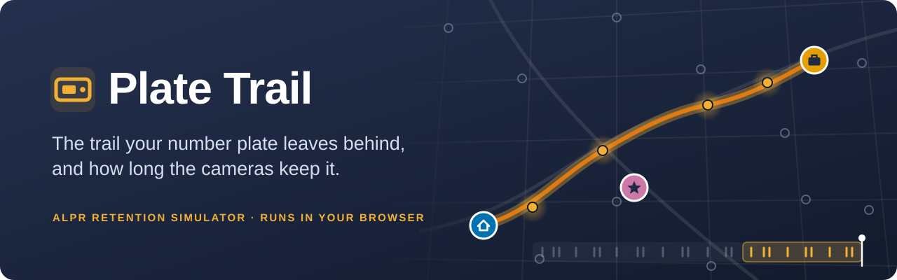
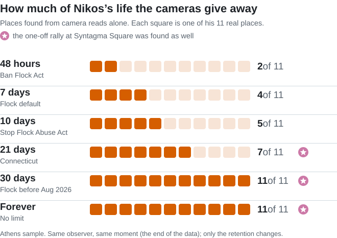
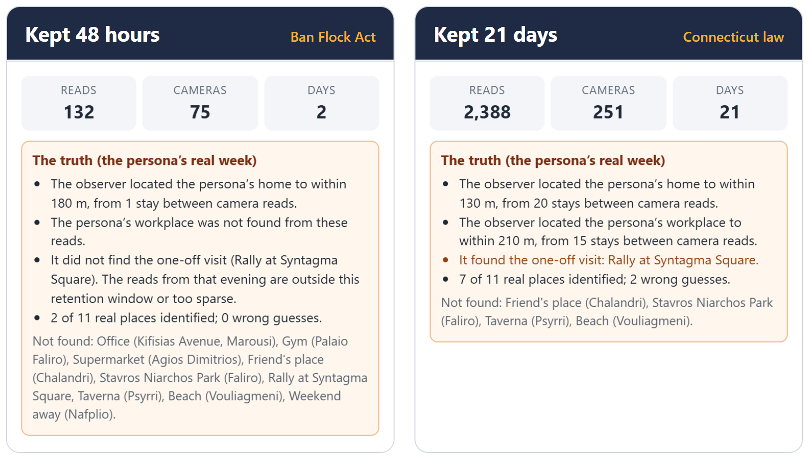
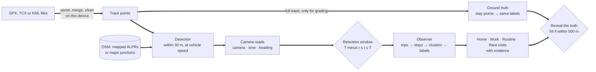
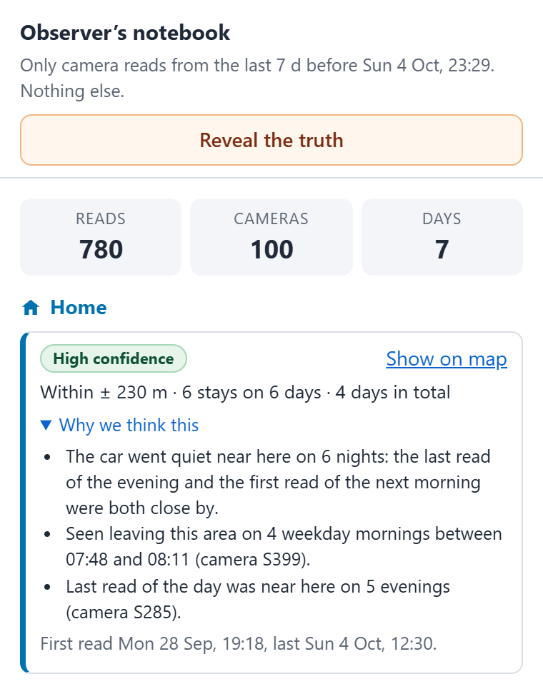

<a id="readme-top"></a>

<div align="center">

<a href="https://kats0ulas.github.io/plate-trail/"></a>

<h3>What would a licence-plate camera network learn about your week?<br>And how much does the data-retention period change that?</h3>

<a href="https://kats0ulas.github.io/plate-trail/"></a>

<a href="https://github.com/Kats0ulas/plate-trail/actions/workflows/ci.yml"></a>


<a href="LICENSE"></a>

[What it shows](#what-the-retention-period-changes) · [Privacy](#your-data-never-leaves-your-browser) · [How it works](#how-it-works) · [Samples](#the-sample-personas) · [Run it locally](#run-it-locally)

</div>

<br>

<p align="center">
  
</p>
<p align="center"><sub>The Athens sample: cameras light up as the car passes, the shaded retention window slides along the timeline, and the observer’s notebook fills in home, work and routine.</sub></p>

## What is this?

More and more roads have cameras that read number plates (**ALPRs**, automatic licence-plate readers). Every time a car drives past one, the camera saves which car it was, where, and when. **Plate Trail** shows what those saved records can reveal about a person, and how much that depends on **how long the records are kept**.

<table>
<tr>
<td width="50%" valign="top"><b>1. Load a week</b><br>Click <b>Try the sample week</b>, or load your own GPS history (GPX, TCX or KML).</td>
<td width="50%" valign="top"><b>2. Watch the replay</b><br>The drives play back on the map. Cameras light up when the car passes them.</td>
</tr>
<tr>
<td width="50%" valign="top"><b>3. Read the notebook</b><br>An observer who sees <i>only</i> the camera reads works out home, workplace, routine and one-off visits, with evidence.</td>
<td width="50%" valign="top"><b>4. Change the retention</b><br>From 48 hours to forever. <b>Reveal the truth</b> grades every guess against what really happened.</td>
</tr>
</table>

> [!NOTE]
> It is a simulation. No real camera records and no number plates are used. The cameras are either real ones mapped in OpenStreetMap or hypothetical ones at every major junction.

## What the retention period changes

**The retention period decides how much of a life can be reconstructed.** Same person, same cameras, same observer, same moment. Only the number of days the records are kept changes.

<picture>
  <source media="(prefers-color-scheme: dark)" srcset="docs/retention-chart-dark.svg">
  
</picture>

- **48 hours is enough to find home.** A single overnight stay between two camera reads puts it within 177 m.
- **About a week gives away the workplace and the routine.**
- **The rally needs about 18 days.** On Wednesday 16 September, about 18 days before the data ends, Nikos went to a rally at Syntagma Square. With 10 days of retention it is gone; with 21 days the observer finds it.
- **30 days finds all 11 places.** With five weeks of data, 30 days and “forever” look alike; with months of history the gap keeps growing.

<p align="center">
  
</p>

<details>
<summary><b>Full numbers for every retention period</b></summary>
<br>

<table>
<tr><th>Retention</th><th>Camera reads visible</th><th>Real places found (of 11)</th><th>Home located to within</th><th>Routine</th><th>Rally found?</th></tr>
<tr><td>48 h (Ban Flock Act)</td><td align="right">132</td><td align="right">2</td><td align="right">177 m</td><td>none</td><td>no</td></tr>
<tr><td>7 d (Flock default)</td><td align="right">780</td><td align="right">4</td><td align="right">143 m</td><td>Medium confidence</td><td>no</td></tr>
<tr><td>10 d (Stop Flock Abuse Act)</td><td align="right">1,056</td><td align="right">5</td><td align="right">111 m</td><td>Medium confidence</td><td>no</td></tr>
<tr><td>21 d (Connecticut)</td><td align="right">2,388</td><td align="right">7</td><td align="right">131 m</td><td>Medium confidence</td><td>yes</td></tr>
<tr><td>30 d (Flock, before Aug 2026)</td><td align="right">3,348</td><td align="right">11</td><td align="right">122 m</td><td>High confidence</td><td>yes</td></tr>
<tr><td>Forever (No limit)</td><td align="right">3,992</td><td align="right">11</td><td align="right">123 m</td><td>High confidence</td><td>yes</td></tr>
</table>

The same observer, at the same moment (the end of the data), with different retention. Regenerate with `npx tsx scripts/eval-demo.ts`.

</details>

## Your data never leaves your browser

- **No backend.** No accounts, analytics, telemetry or error reporting. Parsing and analysis run on your device, in a Web Worker.
- **Nothing is stored.** Your track and the results never touch cookies, `localStorage` or IndexedDB. Close the tab and they are gone. (Public camera and road data is cached in memory only.)
- **Only two kinds of request leave the page:** map tiles and style from `tiles.openfreemap.org`, and camera and road data from the public Overpass API. A Content Security Policy in [`index.html`](index.html) enforces this (`connect-src` lists exactly those hosts) and a test keeps it that way.
- **Coarse queries.** Overpass is never sent your route or its bounding box. The app asks for whole 0.1° grid cells (about 10 km) that your track touches, plus their neighbours, in one request. Honestly: _your track stays in your browser; the tile server and Overpass only learn roughly which area (about city level) you are looking at._
- **Check it yourself:** open the browser’s Network tab, load a file, and watch.

The samples load a saved copy of the same public OSM data from this site, so the one-click demo works even when the shared Overpass servers are busy. “Refresh from OpenStreetMap” fetches it live.

## How it works





1. **Cameras.** Real: nodes and ways tagged `surveillance:type=ALPR` in OpenStreetMap. Simulated: a junction is a node shared by ways of _different_ roads (different `name` or `ref`), so a road that OSM splits into two ways does not count. Nodes within 30 m merge, and a seeded coverage percentage and minimum spacing pick which junctions get a hypothetical camera.
2. **Detection.** For every pair of consecutive GPS points, every camera within the read radius (default 30 m) of that segment logs a read at the interpolated moment of closest approach. Only driving counts (15 to 200 km/h, or slower traffic within 45 s of driving at that speed): ALPRs read plates, so walking produces nothing. Reads of the same camera within 2 minutes count once.
3. **Retention.** At the timeline cursor _T_, the observer sees reads with `T minus retention ≤ t ≤ T` (both ends inclusive; “forever” means every read up to _T_).
4. **Observer, camera reads only.** It never receives the track (enforced by function signatures, an ESLint rule and a test that walks its import graph). Trips split at gaps over 20 minutes; the silence between two trips is a stay near the two bracketing cameras; DBSCAN clusters the stays; shared rules label Home (most time overnight), Work (weekdays 9 to 5 on 3 or more days), recurring places (stays of 30 to 150 minutes on 2 or more days at similar times) and rare visits (one stay over 45 minutes at a place never visited otherwise), plus a weekday schedule. Every inference carries its evidence.
5. **Truth.** The same labelling rules run on stay points from the full GPS track (or, for the samples, the persona’s `truth.json`). An inferred place is a hit if it is within 500 m of a true place with the same label.

All thresholds live in [`src/engine/params.ts`](src/engine/params.ts), each with a comment.

## Retention periods (as of October 2026)

<table>
<tr><th>Period</th><th>Where it comes from</th><th>Source</th></tr>
<tr><td><b>48&nbsp;hours</b></td><td><b>Ban Flock Act</b> (Sen. Sanders, introduced 2 Oct 2026): bars federal ALPR use; the only exceptions (toll collection, future uses Congress approves) must cap retention at 48 hours.</td><td><a href="https://techcrunch.com/2026/10/02/sanders-introduces-bill-to-ban-the-federal-government-from-using-flock/">TechCrunch</a> · <a href="https://www.sanders.senate.gov/wp-content/uploads/Ban-Flock-Act.pdf">bill text</a></td></tr>
<tr><td><b>7&nbsp;days</b></td><td><b>Flock Safety’s default</b> retention since August 2026 (lowered from 30 days).</td><td><a href="https://techcrunch.com/2026/10/02/sanders-introduces-bill-to-ban-the-federal-government-from-using-flock/">TechCrunch</a></td></tr>
<tr><td><b>10&nbsp;days</b></td><td><b>Stop Flock Abuse Act</b> (Sen. Hawley): written approval for searches, deletion after ten days.</td><td><a href="https://www.404media.co/lawmakers-introduce-multiple-laws-to-curb-flock-after-404-media-coverage/">404 Media</a></td></tr>
<tr><td><b>21&nbsp;days</b></td><td><b>Connecticut</b> law (Public Act 26-14, SB 397), in effect since 1 Oct 2026.</td><td><a href="https://ctmirror.org/2026/09/23/ct-laws-oct-1-ai-flock-cameras-immigration-distracted-driving/">CT Mirror</a> · <a href="https://search.cga.state.ct.us/2026/PA/pdf/2026PA-00014-R00SB-00397-PA.pdf">act</a></td></tr>
<tr><td><b>30&nbsp;days</b></td><td>Flock Safety’s default <b>before</b> August 2026.</td><td><a href="https://techcrunch.com/2026/10/02/sanders-introduces-bill-to-ban-the-federal-government-from-using-flock/">TechCrunch</a></td></tr>
<tr><td><b>Forever</b></td><td>No retention limit.</td><td>none</td></tr>
</table>

Bills change. The periods are data in [`src/config/retention.ts`](src/config/retention.ts).

## The sample personas

Most visitors will not upload their own location history, so the samples make the point in one click. All three are **synthetic**: invented people, five weeks of driving and walking generated along real roads (routes from the public OSRM demo server, then GPS noise and sampling), committed as one GPX file per day with a `truth.json` of the persona’s real places and schedule.

<table>
<tr>
<td width="34%" valign="top">

**Athens** · main sample

Nikos lives in Nea Smyrni and works on Kifisias Avenue in Marousi: gym evenings in Palaio Faliro, Saturday shopping in Agios Dimitrios, a friend in Chalandri, Sunday walks at the Stavros Niarchos park, a beach day at Vouliagmeni, a weekend in Nafplio, and on Wednesday 16 September **a rally at Syntagma Square**.

</td>
<td width="33%" valign="top">

**Thessaloniki**

Eleni lives in Kalamaria and works near the railway station: a gym in Toumba, a friend in Pylaia, walks on the Nea Paralia waterfront, a beach day at Perea, a weekend in Kallithea (Halkidiki), and **a rally at Aristotelous Square**.

</td>
<td width="33%" valign="top">

**Patras**

Dimitra lives in Zarouchleika and works at the University of Patras campus in Rio: gym evenings in Agyia, Saturday shopping in Perivola, Sunday walks at the Plaz, a weekend in Nafpaktos across the Rio Antirrio bridge, and an evening **rally at Plateia Georgiou A’**.

</td>
</tr>
</table>

All three use **simulated cameras**: OpenStreetMap lists only a handful of ALPRs in Greece so far (9 in the area the Athens persona drives through as of October 2026, two of them at Syntagma), so the samples ask “what if every major junction had one?”. The places are public landmarks or arbitrary points on ordinary streets, chosen so that a camera sees the car near them; they are not anyone’s address.

## Limitations and ethics

- OpenStreetMap camera data is crowdsourced and incomplete; simulated cameras are hypothetical.
- The inference is a set of simple, documented heuristics, not what any vendor or agency actually runs.
- Real systems also record vehicle make, model and colour, and share data between agencies and jurisdictions, so the real picture can be worse.
- Only use this on your own data. Not legal advice.
- Strava and similar apps only record workouts, not your whole day. For a realistic result use a continuous logger (for example GPSLogger on Android, or OsmAnd trip recording).

## Run it locally

Requires Node 24.

```bash
npm install
npm run dev            # http://localhost:5173
npm test               # unit and end-to-end tests (Vitest)
npm run test:coverage
npm run typecheck
npm run lint
npm run build          # static site in dist/
npm run demo           # regenerate the sample personas and OSM snapshots (uses OSRM and Overpass)
```

`npx tsx scripts/make-demo.ts athens` regenerates one city. The saved camera and junction snapshots are reused while they cover the track; add `refresh-osm` to download them again, or `no-osm` to skip them. Routing responses are cached in `scripts/.cache/`. `scripts/eval-demo.ts` prints how the observer does for every retention period.

**Built with** Vite and TypeScript (strict), no UI framework (a 40-line typed store), MapLibre GL JS, OpenFreeMap (Positron), Turf (`@turf/clusters-dbscan`), `@tmcw/togeojson` (TCX and KML), Flatbush, Vitest, ESLint and Prettier, and GitHub Actions to GitHub Pages.

<details>
<summary><b>Notes from building it</b></summary>
<br>

- TypeScript is pinned to 6.0 because `typescript-eslint` does not support TypeScript 7 yet.
- MapLibre 6 has no default export and resolves its worker from its own module URL, which breaks after bundling. [`src/map/basemap.ts`](src/map/basemap.ts) imports the worker file and calls `setWorkerUrl`, so it is served from our own origin and the CSP needs no `blob:` script.
- GPX is parsed directly rather than with `@tmcw/togeojson`, which drops missing `<time>` elements without leaving a gap and so shifts later timestamps onto the wrong points. togeojson is still used for TCX and KML.
- `@tmcw/togeojson` needs `DOMParser`, which Web Workers lack, so parsing runs on the main thread; detection, inference and ground truth run in the worker.

</details>

## Credits and licences

- Code: MIT, see [LICENSE](LICENSE).
- Camera and road data: © [OpenStreetMap](https://www.openstreetmap.org/copyright) contributors, ODbL. Saved copies in `public/demo/*/cameras.json` and `junctions.json` are ODbL.
- Basemap: [OpenFreeMap](https://openfreemap.org) (OpenMapTiles schema, © OpenMapTiles, © OpenStreetMap contributors).
- Libraries: MapLibre GL JS (BSD 3), Turf (MIT), @tmcw/togeojson (BSD 2), Flatbush (ISC), Vite, Vitest, TypeScript.
- Demo routes: [OSRM](https://project-osrm.org) public demo server, OSM data.

<br>

<div align="center">
<sub>A simulation: no real camera records and no number plates are used. · <a href="#readme-top">Back to top</a></sub>
</div>
